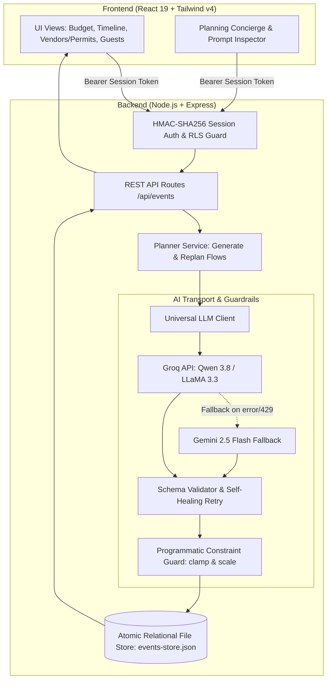

# PlanCraft AI

> A constraint-aware event planning engine that enforces mutual mathematical consistency across budgets, timelines, vendors, and civic logistics, with delta-preserving replanning.

[](#testing)
[](https://www.typescriptlang.org/)
[](https://react.dev/)
[](https://expressjs.com/)
[](https://tailwindcss.com/)
[](LICENSE)

---

## 1. Overview

Most generative AI event tools produce disjointed lists: timelines that ignore vendor lead times, budget line items that exceed stated caps, or dates scheduled after the event has already occurred. Worse, when an event constraint changes (e.g., guest count rises or budget shrinks), conventional tools regenerate the entire plan from scratch, discarding all user customizations and vendor contracts already booked.

**PlanCraft AI** solves this for **High-Stakes Gathering Architecture**—spanning private celebrations (weddings, galas) and civic/community events (festivals, fundraisers). It introduces:
1. **Single-pass generation with mutual consistency:** Budgets, chronological milestones, and vendor/civic tiers are co-generated in a single schema contract.
2. **Programmatic constraint guard:** A deterministic TypeScript clamping layer that validates and bounds LLM outputs (budget ceilings, non-negative numbers, temporal bounds) before persistence, never relying on prompt compliance alone.
3. **Delta-preserving replanning:** Constraint updates calculate mathematical deltas, lock user-modified and booked items, and adjust only flexible allocations while documenting trade-offs in a human-readable rationale.

---

## 2. Key Features

- **Constraint-Bounded Budgeting:** Allocates category line items against a hard total budget; programmatically clamps and scales flexible categories if the LLM output breaches the ceiling.
- **Chronological Milestone Tracking:** Enforces task dependencies bounded strictly between plan creation and the event date, sorting milestones into an actionable run-of-show.
- **Dual-Domain Gathering Pipelines:**
  - *Social Celebrations (Weddings, Birthdays, Galas):* Curates commercial vendor rosters (catering, photography, floral, entertainment) with status tracking (`contacted`, `quoted`, `booked`).
  - *Civic & Community Gatherings:* Automatically switches off commercial vendors and activates **municipal permit tracking** (Health Dept, Fire Marshal, Parks, Sound) and **volunteer shift rosters** with headcount tracking.
- **Guest Registry & Dietary Constraint Feed:** Manages RSVPs and allergen profiles (vegan, nut allergies, gluten-free), feeding live headcounts into catering prompts.
- **Delta-Preserving Replan Engine:** When budget or guest counts change, detects and locks items marked `is_user_edited`, `paid`, or `booked`, recalculating only flexible items to absorb the variance.
- **Interactive Planning Concierge (`askEventAssistant`):** Context-aware assistant that analyzes current budget buffer and milestones, suggesting one-click actions (`add_budget_item`, `add_timeline_task`, `add_vendor`, `rebalance_budget`).
- **Prompt Transparency & Honest Fallbacks:** Includes a live "Inspect Prompt" inspector displaying exact prompt payloads sent to the model. If LLM inference fails or credentials are omitted, the UI transparently displays a flagged deterministic backup template rather than simulating live inference.

---

## 3. How It Works / Architecture

### System Flow
1. **Constraint Ingestion:** The user defines event parameters (name, type, target date, guest count, location, total budget, vibe).
2. **Prompt Synthesis:** `buildGeneratePrompt` constructs an arithmetically grounded prompt embedding current guest counts, dietary feeds, and domain-specific rules.
3. **Universal LLM Inference:** `callLLM` dispatches to Groq (default: `qwen/qwen3.8-27b`) with automatic HTTP 429 rate-limit backoff. If Groq is unavailable, it fails over to Google Gemini (`gemini-2.5-flash`).
4. **Self-Healing Schema Validation:** `validatePlanPayload` verifies types and required fields. If parsing fails, `retryOnceWithCorrection` executes a targeted single-pass correction prompt.
5. **Programmatic Constraint Clamping:** `enforcePlanConstraints` applies deterministic hard rules in code:
   - Budget sum clamped to `total_budget`; flexible items scaled proportionally if exceeded.
   - All task `due_date` values clamped to `[creation_date, event_date]`.
   - Volunteer counts clamped to valid ranges [1, 500]; permit fees sanitized to non-negative numbers.
6. **Persistence & UI Synchronization:** State is persisted to the atomic file-backed relational store (`events-store.json`) and broadcast to the React frontend.
7. **Replan Execution:** When constraints change, `executeReplanFlow` preserves locked items, calculates net deltas, and merges the update with an audit log entry.

### Architecture Diagram



---

## 4. Tech Stack

- **Frontend:** React 19, TypeScript, Tailwind CSS v4, Motion (animations), Lucide React.
- **Backend:** Node.js, Express.js 4.21, `tsx` runtime.
- **LLM Transport & Providers:**
  - *Primary:* Groq Cloud API (`qwen/qwen3.8-27b` or `llama-3.3-70b-versatile`) with exponential 429 backoff parsing.
  - *Secondary Fallback:* Google Gemini API (`@google/genai`, `gemini-2.5-flash`).
- **Security & Multi-Tenancy:**
  - Cryptographically signed HMAC-SHA256 session tokens (`SESSION_SECRET`).
  - Row-Level Security (RLS) verifying ownership on every resource query and mutation.
  - Express rate limiting (200 req/15 min global, 30 req/15 min for LLM routes).
- **Data Persistence:** File-backed relational JSON store with schema versioning and in-memory cache (`events-store.json`).
- **Testing:** Vitest 4 with V8 coverage; **58 automated tests** passing across 6 test suites covering auth, client backoff, constraint clamping, schema validation, delta replanning, and REST endpoints.

---

## 5. Getting Started

### Prerequisites
- Node.js 20+ (tested on Node 20 and Node 22)
- npm 9+
- A Groq API key ([console.groq.com](https://console.groq.com)) or Google Gemini API key ([aistudio.google.com](https://aistudio.google.com))

### Installation
```bash
# 1. Clone repository
git clone <repository-url>
cd PlanCraft-AI

# 2. Install dependencies
npm install

# 3. Configure environment
cp .env.example .env
```

### Environment Variables
Configure the following in your `.env` file:

| Variable | Description | Default / Example |
| :--- | :--- | :--- |
| `GROQ_API_KEY` | Primary inference API key for Groq | `gsk_...` |
| `GROQ_MODEL` | Groq model identifier | `qwen/qwen3.8-27b` |
| `GEMINI_API_KEY` | Secondary fallback API key for Gemini | `AIza...` |
| `PORT` | Local server port | `3000` |
| `NODE_ENV` | Environment mode (`development`, `production`, `test`) | `development` |
| `SESSION_SECRET` | Secret key for signing HMAC-SHA256 session tokens | `your-secret-key-min-32-chars` |

### Running Locally
```bash
# Start backend and Vite development server
npm run dev

# App runs at http://localhost:3000
```

### Building for Production
```bash
npm run build
npm start
```

### Testing & Verification
```bash
# Run full Vitest suite (58 unit and integration tests)
npm test

# Run TypeScript typecheck
npm run lint
```

---

## 6. Assumptions Made

1. **Deterministic Single Currency:** All budget figures, costs, and permit fees are calculated in whole USD integers with no fractional cents or multi-currency exchange.
2. **Model Hierarchy:** Groq is preferred as primary for low-latency (<2.5s) structured generation. Google Gemini 2.5 Flash serves as secondary fallback when Groq credentials are absent or fail.
3. **Categorization Scope:** Gathering types strictly dictate vendor structures:
   - `wedding` and `birthday` provision commercial vendor lines.
   - `community` provisions municipal permit lines and volunteer rosters, omitting commercial vendors.
4. **Session Authentication:** Auth uses lightweight HMAC-SHA256 Bearer tokens with an evaluator demo switcher (`Host (101)` vs `Planner (202)`) to verify multi-tenant isolation without requiring external OAuth/Clerk setup.
5. **Storage Architecture:** Uses a single-node, atomic JSON datastore (`data/events-store.json`) designed for zero-dependency local evaluation and reproducible test runs.

---

## 7. Known Limitations

- **File-Backed Persistence:** Storage is atomic and file-based. It is optimized for single-instance hackathon evaluation and development, not multi-instance distributed deployments requiring distributed ACID transactions.
- **Linear Budget Scaling:** The programmatic budget clamp scales flexible categories proportionally to enforce the hard ceiling. It does not currently run a linear programming solver to prioritize high-priority categories over low-priority ones (though users can lock items manually to achieve this).
- **Offline / Fallback Mode:** When both Groq and Gemini APIs are unreachable, the assistant and generator return documented fallback structures with an explicit `is_fallback: true` flag rather than generating synthetic offline plans.

---

## 8. License

Distributed under the MIT License. See `LICENSE` for details.
